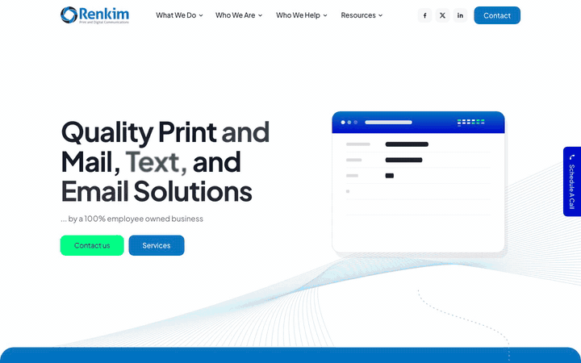

# Renkim redesign: "One Envelope"

**Live demo: [travist6983.github.io/oct-boondoggle/](https://travist6983.github.io/oct-boondoggle/)** · a concept prototype, not the official [renkim.com](https://renkim.com/).



| Start here | | |
|---|---|---|
| [Home](https://travist6983.github.io/oct-boondoggle/) | [Services](https://travist6983.github.io/oct-boondoggle/services/) | [About Us](https://travist6983.github.io/oct-boondoggle/about-us/) |
| [Industries Served](https://travist6983.github.io/oct-boondoggle/industries-served/) | [Print Document](https://travist6983.github.io/oct-boondoggle/print-mail/print-document/) | [Certified Mail](https://travist6983.github.io/oct-boondoggle/print-mail/certified-mail/) |
| [Digital Services](https://travist6983.github.io/oct-boondoggle/digital-services/) | [Email](https://travist6983.github.io/oct-boondoggle/digital-services/email/) | [Ancillary Services](https://travist6983.github.io/oct-boondoggle/ancillary-services/) |
| [Lockbox](https://travist6983.github.io/oct-boondoggle/ancillary-services/lockbox/) | [In the Community](https://travist6983.github.io/oct-boondoggle/in-the-community/) | [Careers](https://travist6983.github.io/oct-boondoggle/careers/) |

Best viewed by scrolling slowly on a laptop or phone. With "reduce motion" turned on in the OS (or by adding `?reduced=1` to the URL), every page is a complete static layout.

More recordings are in [`qa/recording/`](qa/recording/):
- desktop and mobile MP4s for Home, Services, About Us, and Industries Served;
- highlight GIFs for each of those pages.

A scroll-driven prototype of Renkim's site: Home, Services, About Us, Industries Served, all 18 What We Do pages (Print & Mail, Digital, and Ancillary with their service pages), and the 4 Resources pages (Compliance, On the Road, In the Community, Careers). On every page a single envelope is the hero object, and it travels one continuous route through that page's story.
- **Home:** the envelope is born from data, then printed, sealed, stamped, and delivered.
- **Services:** it moves through Print & Mail, Digital, and Ancillary.
- **About Us:** it rides the history timeline.
- **Industries:** it rides a nine-stop route map.
- **What We Do pages:** it performs that page's service in a scroll-driven lab (prints, certifies, verifies, corrects, archives…), then postmarks the core values and ends in a seal.

All copy is Renkim's own, in the live site's palette and type.

## Deliverables

| File | What |
|---|---|
| `design-tokens.json`, `design-tokens.css` | Palette, type, radii, and layout extracted from renkim.com computed styles |
| `content.json`, `content/*.json`, `content/wwd/*.json` | Every string, link, and form field on each page, plus the live-site issues found |
| `RESEARCH.md` | Techniques from United Carriers, Aevion (Riotters), Cerebrium, and Apple |
| `STORYBOARD.md`, `STORYBOARD-PAGES.md`, `STORYBOARD-WWD.md` | Storyboards for the homepage (approved), the inner pages, and the What We Do pages |
| `site/` | The build (Vite multi-page + vanilla JS, GSAP ScrollTrigger + MotionPathPlugin, Lenis) |
| `QA.md` | Test results per page: Lighthouse, frame pacing, reduced motion, links, a11y, open issues |
| `qa/recording/` | Desktop and mobile MP4s per page, plus highlight GIFs |
| `assets/`, `reference/`, `research/` | Downloaded brand assets and photos, live-site reference captures, inspiration frames |

## Run it

```bash
cd site
npm install
npm run dev        # Vite prints the local URL (regenerates illustrations first)
npm run build && npm run preview   # production build at http://localhost:4173
```

Pages:
- `/`, `/services/`, `/about-us/`, `/industries-served/`
- `/print-mail/` and its 3 services
- `/digital-services/` and its 2 services
- `/ancillary-services/` and its 10 services
- `/compliance/`, `/on-the-road/`, `/in-the-community/`, `/careers/` (slim; the live LinkedIn feed widget is a plain link card)

Every page folder is built automatically (`vite.config.js` walks for `index.html`). Links between built pages are local; Portal pages and everything else go to renkim.com.

Query flags for demos and QA:
- `?reduced=1` forces the static reduced-motion page.
- `?motion=1` forces motion even when the OS asks for reduced motion.

## How it's built

- **Static first.** Each page's HTML is complete and readable on its own. A head script adds `motion-ok` or `motion-reduce` before first paint, so the layout never shifts. The page's motion module loads after `load` + idle, adds `is-live`, and can fail without breaking anything.
- **Shared chrome.** The header, mega menu, footer, certifications, and demo form are partials in `src/partials/`. A small Vite plugin inlines them, along with the generated SVGs (`<!--@partial name-->`, `<!--@svg name-->`).
- **Inner-page shell.** `src/styles/inner.css` holds the live blue page hero and glass chips. The header sits on the hero with a white logo, then takes the hero's blue once the page moves.
- **Per-page code.**
  - Entry: `src/pages/<page>.js`
  - Styles: `src/styles/pages/<page>.css`, split per page
  - Journey: `src/motion/pages/<page>.js`
  - Illustrations: `scripts/illustrations/<page>.mjs` writes `src/svg/<page>-*.svg`
- **Motion runtime** (`src/motion/runtime.js`) handles Lenis on fine pointers, the fixed envelope layer, the progress bar, and rebuilds on resize. Each page supplies `buildJourney(ctx)` made of stages (`src/motion/geom.js`, `kit.js`, `stages.js`).
- **The route.** Every stage owns its route segment (`<svg class="route">`, sized 1:1 to its frame). The envelope is positioned each frame from `MotionPathPlugin.getPositionOnPath`.
  - In normal stages it is held at 50% of the viewport.
  - Pinned stages (`position: sticky`) map scroll progress to keyframes.
  - Every visual state is a pure function of scroll, so scrolling backwards replays the story in reverse.
- **Mobile** has its own geometry: a left-gutter rail, a smaller envelope, sticky frames with the art on top, and native touch scroll (no Lenis).
- **What We Do template.** `src/styles/wwd.css`, partials `wwd-sidebar`, `wwd-band-*`, `wwd-pills`, `wwd-values`, and `src/motion/pages/wwd-common.js` (`startWwd(buildLab)`: hero → gutter → the page's lab → employee band → industries band → core values → seal). Each family (`wwd-print`, `wwd-digital`, `wwd-anc-a`, `wwd-anc-b`) has its own entry, CSS, journey, and illustration script.
- **Images.** `scripts/images.mjs` builds AVIF, WebP, and JPEG derivatives of the live photos into `public/img/pages/`.

## QA scripts (`site/scripts/`)

| Script | Purpose |
|---|---|
| `qa-shots.mjs <url> <out> <w> <h> [reduce]` | Homepage: screenshot every storyboard checkpoint |
| `qa-page-shots.mjs <url> <out> <w> <h> [reduce]` | Any page: screenshot the checkpoints it declares with `data-qa` / `data-qa-steps` |
| `perf-scroll.mjs <url> <trace> <w> <h> <cpu>` | Wheel-scroll the page, report frame pacing, save a DevTools trace |
| `verify-content.mjs <url> <content.json>` | Check every link, phone, email, CTA, and string is on the page |
| `a11y-keyboard.mjs <url>` | Homepage: tab order, mega menu, form errors, heading outline |
| `a11y-page.mjs <url> [w] [h]` | Any page: full tab walk (focus ring, on screen, not under the header), headings, alts, anchors, ids, names |
| `links-local.mjs [base]` | Every local link on every page resolves to a page and an existing `#fragment` |
| `record.mjs`, `record-page.mjs <url> <out.mp4> <w> <h> [secs]` | Record a page's journey as an MP4 |

They use `playwright-core` with the locally installed Google Chrome (`channel: 'chrome'`).

## Deploy

Every push to `main` runs [`.github/workflows/pages.yml`](.github/workflows/pages.yml), which builds the site under the repo's sub-path and publishes it to GitHub Pages.

The deploy sets two variables:
- `BASE_PATH=/<repo>/` rewrites the root-relative links, images, and fonts for the sub-path.
- `DEMO=1` adds a slim "concept redesign" ribbon and `noindex`, so the preview is never mistaken for, or indexed as, the official site.

To reproduce the deploy locally:

```bash
cd site
BASE_PATH=/oct-boondoggle/ DEMO=1 npm run build
BASE_PATH=/oct-boondoggle/ npx vite preview
```

Not in the repo, because they are bulky or regenerable:
- screenshots, performance traces, and raw Lighthouse JSON (`qa/lighthouse/SUMMARY.md` has every page's scores);
- full-resolution original photos (the web derivatives are in `site/public/img/pages/`);
- live-site HTML dumps.

## Rights

This is a design prototype for demonstration. Renkim's name, logo, copy, certifications artwork, and company photography belong to Renkim Corporation. Stock photography is from Pexels (Pexels License). Partner logos on the Community page belong to their organizations. Fonts: Plus Jakarta Sans (SIL Open Font License). Libraries: GSAP and Lenis.

## Before launch

See QA.md › Remaining issues:
- Wire the form endpoint (`src/form.js`, marked `TODO(endpoint)`).
- Do a real-device and Safari/Firefox pass.

Client content decisions from 2026-10-11 are applied on every page: no incident banner, no Aelieve credit, no chat widget, and live wording for "Phone Return Mail Processing".
